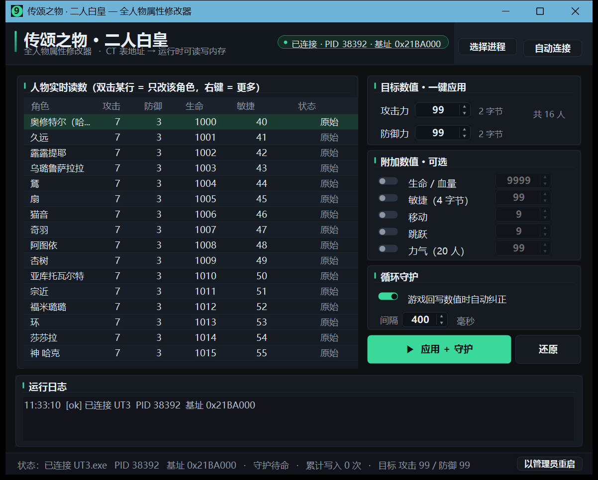
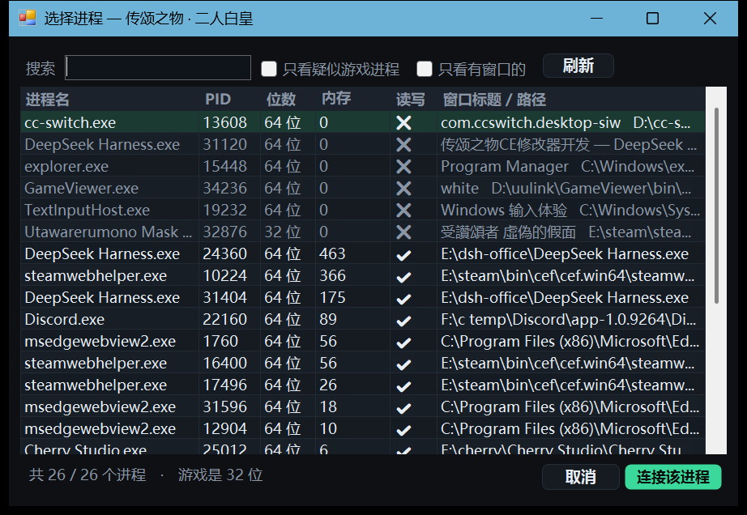

# 传颂之物 · 两人的白皇 — 全人物属性修改器

> 给《受讚頌者 兩人的白皇》(Utawarerumono: Mask of Truth) 用的小工具：读取游戏进程内存，
> 把 CT 表里 **16 名角色的攻击力 / 防御力一键写成 99**，可选同时改生命・敏捷・移动・跳跃・气力，
> 带「循环守护」定时器，游戏把数值重算回去也会被自动改回来。

游戏是 32 位程序（任务管理器里显示为 `UT3`），本节目的成品同样是零依赖的单个 exe，双击即用。



---

## 目录

- [为什么需要它](#为什么需要它)
- [功能](#功能)
- [快速开始](#快速开始)
- [使用说明](#使用说明)
- [地址表](#地址表)
- [命令行](#命令行)
- [自行编译](#自行编译)
- [离线自测](#离线自测)
- [项目结构](#项目结构)
- [常见问题](#常见问题)
- [免责声明](#免责声明)

---

## 为什么需要它

在 Cheat Engine 里把 CT 表里所有角色的攻击力 / 防御力改成 99，退出 CE 之后很快又变回原值，重开游戏更是全部失效。原因有两个：

1. **这些字段不是只读常量**。游戏在读档、进入战斗、升级、结算时会按成长表重新计算这几个值并**回写**内存，所以 CE 里冻结一次只是赢了一个瞬间。
2. **重启后内存重新初始化**。CT 表里给的是静态地址（模块基址 + 偏移），重启后地址一样，但内容回到存档/成长表算出来的值。

CT 表里没有 AutoAssembler 脚本可拦，因此唯一稳妥的路子是**外部反复覆盖**：本工具用一个定时器（默认 400 ms 一次）把目标值重新写进去，只要工具开着，数值就一直保持在你要的数字上。

---

## 功能

- **一键写入 16 人攻击 / 防御 = 99**（目标值可自己改，1–65535）
- **可选附加项**：生命 / 血量、敏捷（4 字节）、移动、跳跃、气力（本作气力是 2 字节，20 条）—— 每项单独开关
- **循环守护**：定时器反复覆盖，游戏回写也能压住，间隔 100–5000 ms 可调
- **一键还原**：第一次改某个地址前自动备份原始值到 `二人白皇-属性备份.ini`，随时精确还原
- **CE 式选择进程**：列出全部进程（进程名 / PID / 位数 / 内存 / 读写权限 / 窗口标题），支持搜索、简繁归一、★ 疑似游戏高亮；双击或回车即连接
- **记住上一次的进程**：连过一次之后，下次启动自动连它
- **自动重连**：游戏重启、进程退出后再点「自动连接」即可；连接会按匹配分数依次尝试，最高分那个没权限时自动退而求其次
- **实时读数表**：16 行实时显示当前 攻击 / 防御 / 生命 / 敏捷 与状态（`原始` / `✔ 生效` / `失败`），双击某行只改该角色，右键可单独还原
- **纯 WinForms 自绘深色界面**，不依赖任何第三方库；`app.manifest` 声明 DPI 感知，高分屏不糊
- **完整命令行**：`--apply / --off / --guard / --dump / --list / --ps / --picker / --selftest`，方便脚本化和离线验证

---

## 快速开始

1. 启动游戏（Steam 版《受讚頌者 兩人的白皇》），进到有角色的画面。
2. 双击 `二人白皇-属性修改器.exe`。
   - 工具会自动尝试连接 `Utawarerumono Mask of Truth.exe`；
   - 如果游戏是以**管理员身份**运行的，工具会读不到内存 —— 点右下角 **「以管理员重启」**，重启后再让它自动连接。
3. 目标数值默认 `攻击力 99 / 防御力 99`，点 **「▶ 应用 + 守护」**。
4. 表格里 16 行变成 `99 / 99`、状态列出现绿色 `✔ 生效` 即成功。保持工具开着，数值就一直是 99。

想改回来点 **「还原」**。

---

## 使用说明

### 连接哪个进程

页头右侧两个按钮：

| 按钮 | 行为 |
| --- | --- |
| **自动连接** | 先按名字匹配（`Utawarerumono Mask of Truth` / `Mask of Truth` / `UT3` / `兩人的白皇` / `二人的白皇`），并给「上次用过的进程名」加权，命中多个时按分数从高到低依次尝试 |
| **选择进程** | 打开 CE 那样的进程列表，手动挑一个连上，并把这次的选择记到 `二人白皇-设置.ini` |



进程列表里：

- `★` = 疑似游戏（进程名或窗口标题命中，默认排最前）
- `✔ / ✖` = 能不能读写（`✖` 基本都意味着权限不足，用「以管理员重启」再来）
- 搜索框做了简繁归一，搜「传颂之物」也能命中标题为「受讚頌者 兩人的白皇」的进程

> 一部二部同一个引擎，进程名很像（`UT2` / `UT3`）。本工具会自动排除第一部的进程，不会连错。

### 目标数值 / 附加数值

- **目标数值 · 一键应用**：攻击力、防御力，作用于全部 16 人。
- **附加数值 · 可选**：五项各自独立开关。关闭的项不会被写入，也不会被还原逻辑覆盖。

### 循环守护

打开后每 `间隔` 毫秒重新写一次（只写与目标不一致的字段，读写都做了差异判断，开销很小）。
页脚会累计显示「累计写入 N 次」。关掉守护后数值不再被维持，但仍然保留当前值，直到游戏自己回写。

### 还原

- **还原**按钮：把备份里记录的原始值全部写回（只还原备份中存在的地址，所以「只改过攻击/防御」就只还原这两项）。
- 表格里右键 → 「还原该角色的原始值」：只还原一行。

---

## 地址表

模块基址在 CT 表里固定为 `0x400000`，运行时地址 = 实际模块基址 + (绝对地址 − 0x400000)。
下表是**绝对地址**（与 CT 表一致）。角色属性块布局：

| 偏移 | 字段 | 字节数 |
| --- | --- | --- |
| `+0x00` | 生命 / 血量 | 2 |
| `+0x04` | 攻击力 | 2 |
| `+0x06` | 防御力 | 2 |
| `+0x08` | 敏捷 | 4 |
| `+0x0C` | 移动 | 2 |
| `+0x0E` | 跳跃 | 2 |
| `+0x34` | 气力 | **2** |
| `−0x0A` | 经验 | 2（仅部分角色） |

### 16 名角色（基址 = 生命 / 血量）

| 角色 | 生命/血量 | 攻击力 | 防御力 | 敏捷 | 经验 |
| --- | --- | --- | --- | --- | --- |
| 奥修特尔（哈克） | `0x00B06740` | `0x00B06744` | `0x00B06746` | `0x00B06748` | — |
| 久远 | `0x00B069E8` | `0x00B069EC` | `0x00B069EE` | `0x00B069F0` | `0x00B069DE` |
| 露露提耶 | `0x00B06F38` | `0x00B06F3C` | `0x00B06F3E` | `0x00B06F40` | — |
| 乌璐鲁萨拉拉 | `0x00B071E0` | `0x00B071E4` | `0x00B071E6` | `0x00B071E8` | — |
| 鵟 | `0x00B07488` | `0x00B0748C` | `0x00B0748E` | `0x00B07490` | — |
| 扇 | `0x00B07730` | `0x00B07734` | `0x00B07736` | `0x00B07738` | — |
| 猫音 | `0x00B079D8` | `0x00B079DC` | `0x00B079DE` | `0x00B079E0` | — |
| 奇羽 | `0x00B07C80` | `0x00B07C84` | `0x00B07C86` | `0x00B07C88` | — |
| 阿图依 | `0x00B07F28` | `0x00B07F2C` | `0x00B07F2E` | `0x00B07F30` | — |
| 杏树 | `0x00B081D0` | `0x00B081D4` | `0x00B081D6` | `0x00B081D8` | — |
| 亚库托瓦尔特 | `0x00B08478` | `0x00B0847C` | `0x00B0847E` | `0x00B08480` | — |
| 宗近 | `0x00B08720` | `0x00B08724` | `0x00B08726` | `0x00B08728` | — |
| 福米璐璐 | `0x00B089C8` | `0x00B089CC` | `0x00B089CE` | `0x00B089D0` | — |
| 环 | `0x00B09C60` | `0x00B09C64` | `0x00B09C66` | `0x00B09C68` | `0x00B09C56` |
| 莎莎拉 | `0x00B09F08` | `0x00B09F0C` | `0x00B09F0E` | `0x00B09F10` | `0x00B09EFE` |
| 神 哈克 | `0x00B0DEC8` | `0x00B0DECC` | `0x00B0DECE` | `0x00B0DED0` | — |

> CT 表里奇羽那组把「跳跃」写了两条（`0x00B07C8E` 与 `0x00B07C8C`）、并且缺「移动」；工具按统一布局处理（移动 `+0xC`、跳跃 `+0xE`），不影响攻击/防御。

### 气力（20 条，2 字节）

`0x00B06A40` 久远、`0x00B06798` 奥修特尔（哈克）、`0x00B06CE8` 三、`0x00B06F90` 露露缇耶、`0x00B07238` 乌璐鲁萨拉拉、`0x00B074E0` 鵟、`0x00B07788` 扇、`0x00B07A30` 猫音、`0x00B07CD8` 奇羽、`0x00B07F80` 阿图依、`0x00B08228` 杏树、`0x00B084D0` 亚库托瓦尔特、`0x00B08778` 宗近、`0x00B08A20` 福米璐璐、`0x00B08CC8` 海马、`0x00B08F70` 十六、`0x00B09218` 鱼雷、`0x00B09CB8` 环、`0x00B09F60` 莎莎拉、`0x00B0DF20` 哈克神。

> 气力条目与角色属性块同样是 `0x2A8` 的步长，但多了「三 / 海马 / 十六 / 鱼雷」四个只有气力条目的角色。

---

## 命令行

```
二人白皇-属性修改器.exe [命令] [--pid N] [--proc 名字] [--base 0x地址]
```

| 命令 | 说明 |
| --- | --- |
| `--apply [atk] [def] [hp] [agi] [mov] [jmp] [pow]` | 应用数值（省略的参数用界面里的默认值；只写你给的那几项） |
| `--off` | 按备份还原 |
| `--guard <秒> [atk] [def] ...` | 循环守护跑指定秒数，打印期间纠正了多少次 |
| `--dump` | 打印 16 人当前读数 |
| `--list` | 打印完整地址表（含与 CT 的交叉校验） |
| `--ps` | 打印进程列表 + 记住的上次进程名 |
| `--picker` | 只弹「选择进程」窗口（自动化截图用） |
| `--selftest` | 自检：自己分配内存、逐地址读写往返、未映射地址读取必须失败 |
| `--pid N` / `--proc 名字` | 指定进程 |
| `--base 0x地址` | 覆盖模块基址（仅用于对着假进程做离线验证） |

示例：

```bat
:: 把 16 人攻击/防御写成 99，守护 8 秒
二人白皇-属性修改器.exe --guard 8 99 99

:: 只改攻击力
二人白皇-属性修改器.exe --apply 200

:: 自检（不需要游戏）
二人白皇-属性修改器.exe --selftest
```

`--selftest` 正常输出结尾为：

```
----
pass = 145   fail = 0
RESULT: PASS
```

---

## 自行编译

需要 .NET Framework 4.x（Win7/8/10/11 自带）。**双击 `build.cmd`** 即可，它会自动找 `csc.exe`：

```bat
%WINDIR%\Microsoft.NET\Framework64\v4.0.30319\csc.exe ^
  /nologo /target:winexe /platform:anycpu /optimize+ /codepage:65001 ^
  /win32manifest:app.manifest ^
  /r:System.dll /r:System.Core.dll /r:System.Drawing.dll /r:System.Windows.Forms.dll ^
  "/out:二人白皇-属性修改器.exe" Program.cs
```

> `build.cmd` 是 CRLF 换行；若改用 LF 保存，cmd 会报 `'mework' 不是内部或外部命令` 之类的怪错。
> 重新编译前先关掉正在运行的 exe，否则会 `error CS0016: 未能写入输出文件…另一个程序正在使用此文件`。

---

## 离线自测

`tests/` 里带了假游戏进程 `FakeGame.cs`（可编译成 `UT3.exe`）：它自己 `VirtualAlloc` 一块 0x8000 的内存，把 16 个角色的属性块摆在上面，
按 `fakegame-init.txt`（mod/want/alloc/base/pid）公布基址，并每 0.5 秒把内存快照写进 `fakegame-state.txt`；带 `hold` 参数时不再定时回写默认值。

```bat
:: 1) 起假进程（600 秒后自动退出，hold = 不自动回写）
tests\UT3.exe 600 hold

:: 2) 用它的 base 应用数值（--base 覆盖模块基址）
二人白皇-属性修改器.exe --apply 99 99 5000 33 6 3 77 --pid <PID> --base 0x<BASE>

:: 3) 看结果（应显示 atk=99 def=99 ...）
type tests\fakegame-state.txt
```

这条 E2E 同时覆盖 2 字节（生命/攻击/防御/移动/跳跃/气力）与 4 字节（敏捷）两类读写路径。
GUI 截图也可以用 `tests/Shot.exe <输出.png> <窗口标题关键字>` 自动抓。

---

## 项目结构

```
二人白皇-属性修改器.exe     成品（.NET Framework 4.x，无需安装）
Program.cs                 全部源码（C# 5 / WinForms 单文件）
build.cmd                  一键重编译
app.manifest               asInvoker + DPI 感知
screenshot/                界面截图
tests/FakeGame.cs          假游戏进程，用于离线 E2E
tests/Shot.cs              窗口截图小工具
```

运行时会在 exe 同目录生成：

| 文件 | 作用 |
| --- | --- |
| `二人白皇-设置.ini` | 记住上次连接的进程名 / PID |
| `二人白皇-属性备份.ini` | 原始数值备份（`B06744=7|2` 这种格式，别手改） |
| `cli-out.txt` | 命令行模式的输出副本（便于脚本查看） |
| `错误日志.txt` | 只出异常时才生成 |

---

## 常见问题

**Q：连上了但表格全是 `?` / 状态列显示「失败」**
A：多半是权限。右键 → 以管理员身份运行，或用工具里的「以管理员重启」。

**Q：改了之后过一会儿又回去了**
A：开「循环守护」。数值是在游戏自己的回合（读档、战斗结算、升级）被重算回写的，守护开着就会自动压住。

**Q：自动连接会不会连到第一部的进程？**
A：不会。名字匹配会先排除第一部的特征词（`UT2` / `Mask of Deception` / `虛偽的假面`），只会连第二部。

**Q：支持第一部吗？**
A：第一部（《虛偽的假面》）有独立仓库，界面和用法完全一致，人物 12 名、气力 12 条：
`UtawarerumonoMaskOfDeception`。

**Q：会被封号吗？**
A：纯单机、纯本地内存读写，不联网、不改游戏文件，也不需要反作弊。风险由你自行判断。

---

## 免责声明

仅供个人学习与单机娱乐使用。请自行备份存档；因使用本工具造成的存档异常、游戏崩溃等后果由使用者承担。
本项目与 Aquaplus / 传颂之物官方无任何关联。
